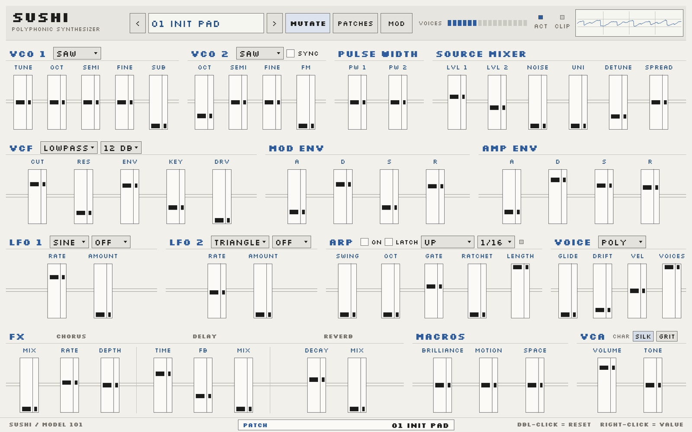
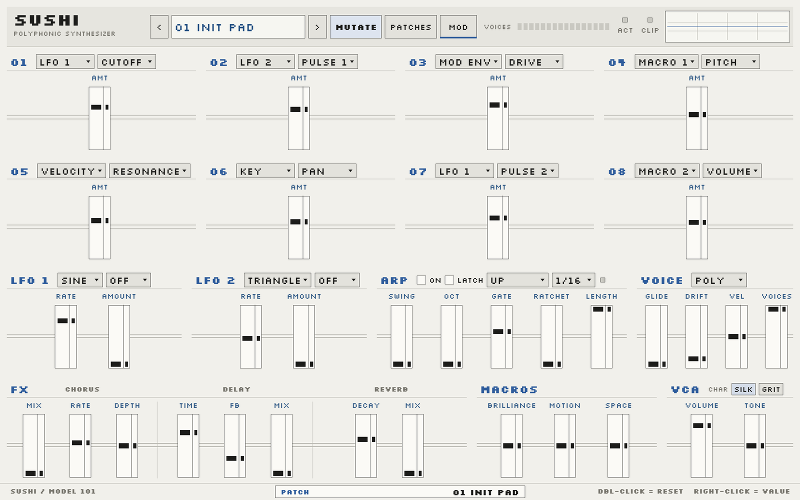
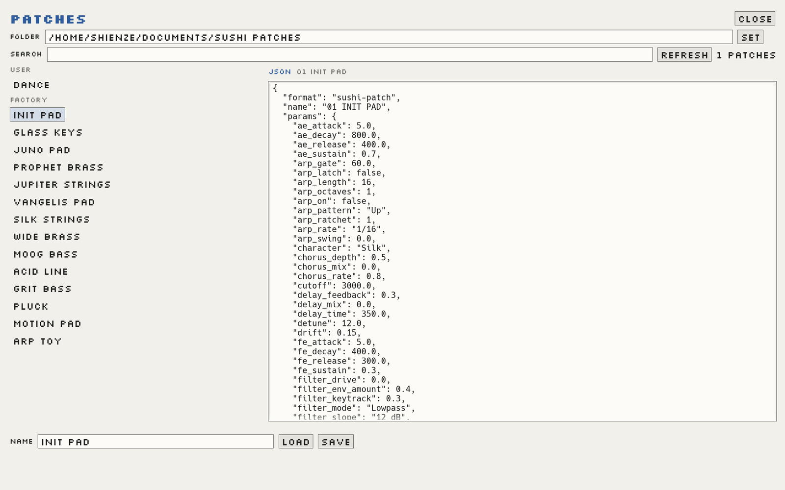

# SUSHI



A compact, mouse-first polyphonic synthesizer.
**CLAP · VST3 · Standalone**

[](https://github.com/77-223255/sushi/releases/tag/v0.0.1)
[](LICENSE)

[Download 0.0.1](https://github.com/77-223255/sushi/releases/tag/v0.0.1)

## Sound

- Two band-limited oscillators, sub oscillator, hard sync, phase FM, unison
- Filter slopes 12 dB / 24 dB OLD (legacy) / 24 dB (new corrected ladder with
  working resonance), with drive
- ADAA anti-aliased saturation and drive
- Dual ADSR envelopes, dual LFOs, analog drift
- 8-slot modulation matrix
- Arpeggiator with swing, ratchet, gate, length and latch
- Chorus, ping-pong delay, modulated FDN reverb
- Modern: precise, high-performance digital DSP; the 48 kHz factory sound is
  preserved and the reverb damping is sample-rate-correct at other rates
- Legacy: old-school rough, analog-warm path (Freeverb, cascaded SVF, raw tanh)
  with deterministic per-voice component tolerances, slower drift,
  even-harmonic warmth and a fixed HF loss
- Patch JSON and parameter IDs are unchanged; the same patch works in both
  flavors, and old projects open in Legacy
- 26 factory presets, 95 patch parameters

## Interface

- Modern: light SH-101-inspired faceplate; Legacy: warm vintage palette, all vertical faders
- Coarse lane plus a separate fine lane on every fader
- Click the SUSHI wordmark to switch Modern / Legacy
- Full-page JSON patch browser
- Right-click value entry, mouse wheel, double-click reset
- 960 × 600 design, continuous scaling, opens at 1280 × 800
- Built for the mouse; no live MIDI performance required

## Screenshots

### Modulation matrix



### Patch browser



## Install

Download the release archive and unpack it:

```bash
tar -xzf sushi-0.0.1-linux-x86_64.tar.gz
cp -r sushi.clap ~/.clap/
cp -r sushi.vst3 ~/.vst3/
```

The standalone binary is `sushi`.

## Build

Requires Rust 1.88+ on Linux.

```bash
cargo build --release
cargo nice-plug bundle sushi --release
```

Bundles are written to `target/bundled/`.

## License

MIT. See [LICENSE](LICENSE).
