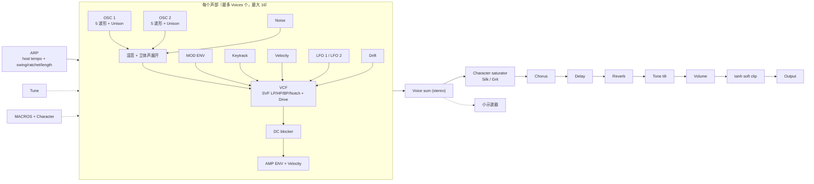

# sushi

一个合成器项目。

## 功能

**声音**

- 双振荡器：Sine / Triangle / Saw / Square / Pulse，支持八度、半音、微调、脉宽、电平
- 锯齿 / 方波 / 脉冲 / 三角均为 PolyBLEP 限带波形，不产生混叠
- 每个振荡器 1–4 重 Unison，带失谐与立体声展宽；每个声部随机起始相位，避免和弦相位抵消
- 噪声、TPT 状态变量滤波器（LP/HP/BP/Notch）带 Drive，共振越高输入越柔和
- 每声部带直流阻断（DC Blocker），波形不会累积直流偏置
- 独立的 Amp / Filter ADSR 包络
- 双 LFO（Sine / Triangle / Saw / Square / S&H），可路由到音高、滤波、音量、脉宽
- 每声部模拟漂移（Drift），Poly / Mono / Legato、Glide
- **Tune** 全局调音（±12 半音）与 **Voices** 复音数限制（1–16，超出时抢最老声部）
- **Character**：Silk / Grit 两档性格，统一改变饱和、驱动和漂移
- **宏控制**：Brilliance / Motion / Space，每个同时带动一组参数
- 力度同时影响音量与滤波器

**可玩性**

- **琶音器**：Up / Down / UpDown / Random / As Played，1/4–1/32，1–3 八度，跟随宿主速度
- 琶音器还带 **Gate**、**Latch**、**Swing**（0–75%，长短交替且平均不变）、**Ratchet**（每步 1–4 次重触发）与 **Length**（1–16 步）
- 琶音器面板右侧有 16 颗 **POS** 指示灯，亮起的一颗就是当前所在的步（不随 Ratchet 的重触发跳动）
- **效果链**：Chorus（湿声低通）、Delay（反馈低通 + 软削波）、Reverb（15 ms 预延迟 + 输入低通）；混音为 0 时完全旁路
- **14 个工厂预设** + **MUTATE** 随机演化
- 小示波器、ACT / CLIP / 声部 LED、琶音 LED

**界面**

- 平面（SH-101 蓝图风格）单页面板：彩色分区标题、1 px 细线、竖向推子（黑色滑块完全嵌入凹槽）、所有参数可精确输入数值、波形/模式点击弹出
- 双击推子、开关、性格按钮或弹窗，即可将参数恢复到出厂默认值
- 4 行分区（学习 SH-101 蓝图的合理布局）：VCO 1 / VCO 2 / SOURCE MIXER / VCF · PULSE WIDTH / MOD ENV / AMP ENV / LFO / CLK · ARP / VOICE · FX / MACROS / VCA
- 标题栏的 **PATCHES** 按钮打开补丁浏览器：选择目录、列出补丁、读取与保存（同名文件需连按两次 SAVE 才会覆盖）
- LCD 显示当前声音的名字：用户补丁显示补丁名，工厂预设显示编号与预设名，被改动过时名字后带 `*`


## 结构原理图

这是当前**真实**的部件组合，不是概念图。以后增删部件时以它为准。



```text
MIDI/ARP -> Voice: OSC1 + OSC2 + Noise -> VCF -> DC block -> Amp env
         -> Character -> Chorus -> Delay -> Reverb -> Tone -> Volume -> tanh -> Out
```

**调制耦合（都在音频线程实时计算）**

- 滤波截止频率：`cutoff × 2^(MOD ENV × 5 oct + keytrack + velocity × 1.5 + LFO × 4 oct + drift)`
- 音高：`key + glide + Tune + LFO × 2 st + drift`，再叠加每个振荡器的八度/半音/微调与 Unison 失谐
- 宏：Brilliance 推 cutoff/共振/驱动；Motion 推 LFO 深度与 Drift；Space 推 Chorus/Delay/Reverb 的 Mix
- Character：Silk / Grit 统一改变饱和器、滤波驱动、漂移
- Voices：限制同时发声数，超出时抢最老声部；ARP 自己生成的声部不计入该限制
- FX：三个 Mix 为 0 时完全旁路，不消耗处理时间

## 部件与参数

| 面板区域 | 主要参数（id） | 实现位置 |
|---|---|---|
| VCO 1 / VCO 2 | `osc1_*` / `osc2_*`（wave、octave、semi、fine） | `src/dsp/osc.rs`、`src/dsp/voice.rs` |
| SOURCE MIXER | `osc*_level`、`noise_level`、`unison`、`detune`、`spread` | `src/dsp/voice.rs` |
| PULSE WIDTH | `osc1_pw`、`osc2_pw` | `src/dsp/osc.rs` |
| VCF | `filter_mode`、`cutoff`、`resonance`、`filter_env_amount`、`filter_keytrack`、`filter_drive` | `src/dsp/filter.rs` |
| MOD ENV | `fe_attack/decay/sustain/release` | `src/dsp/adsr.rs` |
| AMP ENV | `ae_attack/decay/sustain/release` | `src/dsp/adsr.rs` |
| LFO / CLK | `lfo1_*`、`lfo2_*`（wave、rate、amount、target） | `src/dsp/lfo.rs` |
| VOICE | `poly_mode`、`glide`、`drift`、`velocity`、`voices`、`tune` | `src/dsp/voice.rs`、`src/lib.rs` |
| ARP | `arp_*`（on、pattern、rate、octaves、gate、latch、swing、length、ratchet） | `src/dsp/arp.rs` |
| FX | `chorus_*`、`delay_*`、`reverb_*` | `src/dsp/fx.rs` |
| MACROS / VCA | `macro_bright/motion/space`、`character`、`volume`、`tone` | `src/lib.rs` |
| PATCHES | 全部 67 个参数（JSON） | `src/patch.rs`、`src/editor/presets.rs` |

## 修改指南

- **加参数**：`src/params.rs` 定义 → `src/patch.rs` 的 `sushi_params!` 表加一行 → 面板加控件 →
  预设/测试更新。补丁读写与恢复默认会自动覆盖新参数。
- **删部件**：先删面板控件，再删参数、DSP 实现、`sushi_params!` 表项和相关测试；最后更新上面的
  原理图与参数表。不要只删 UI，否则补丁里会留下幽灵参数。
- **改耦合**：宏与 Character 是**读取时**叠加，不写进补丁；在 `src/lib.rs::process` 里改。
  每声部的调制在 `src/dsp/voice.rs`，全局效果在 `src/dsp/fx.rs`。
- **改声音**：振荡器 `dsp/osc.rs`（限带波形）、滤波器 `dsp/filter.rs`（SVF/驱动/共振衰减）、
  包络 `dsp/adsr.rs`、效果 `dsp/fx.rs`。改完跑 `cargo test`，DSP 与补丁都有单测。
- **改布局**：只动 `src/editor.rs`；参数 id 与引擎无关，UI 可以随时重排。

## 补丁（Patch）

补丁是纯 JSON 文本，任何语言都能读写。保存时写出全部 67 个参数，读取时先回到出厂默认值，
再写入文件中出现的参数——缺失的参数保持默认，未知参数只警告不报错，因此新旧版本互相兼容。

```json
{
  "format": "sushi-patch",
  "version": 1,
  "name": "JUNO PAD",
  "params": {
    "osc1_wave": "Saw",
    "osc1_octave": 0,
    "osc1_fine": 0.0,
    "cutoff": 2400.0,
    "filter_mode": "Lowpass",
    "arp_pattern": "Up",
    "arp_rate": "1/16",
    "poly_mode": "Poly",
    "arp_on": false,
    "volume": 0.5
  }
}
```

- `format` / `version` / `name` 可省略；没有 `params` 时，整个根对象就是参数表，方便手工编辑
- 参数 id 为稳定名称，值都是**普通值**：浮点为 JSON 数字、整数为 JSON 整数、布尔为 `true`/`false`（也接受 `0`/`1`）
- 枚举可写显示名（大小写不敏感，如 `Saw`、`Lowpass`、`1/16`、`As Played`、`S&H`）或整数序号
- 浮点超出范围会被夹到范围内；非有限数值会报错
- `volume` 是线性增益（`1.0` = 0 dB，`0.5` ≈ −6 dB），其余单位与面板一致（Hz、ms、%、音分）

默认补丁目录：**`~/Documents/Sushi Patches`**（找不到 HOME 时用 `sushi-patches`）。在标题栏点
**PATCHES** 打开补丁浏览器，**FOLDER** 里可以填别的目录（`~/` 会展开成 HOME），按 **SET** 生效并
写入配置文件；列表里点一个名字即可读取，**NAME** + **SAVE** 则把当前声音写成补丁。用户选择的目录保存在
配置文件 `$XDG_CONFIG_HOME/sushi/config.json`（未设置时为 `~/.config/sushi/config.json`）：

```json
{
  "patch_dir": "/home/user/Documents/Sushi Patches"
}
```

## 工厂预设

共 14 个：INIT PAD · GLASS KEYS · JUNO PAD · PROPHET BRASS · JUPITER STRINGS · VANGELIS PAD ·
SILK STRINGS · WIDE BRASS · MOOG BASS · ACID LINE · GRIT BASS · PLUCK · MOTION PAD · ARP TOY

工厂预设就是内嵌的补丁 JSON，与用户保存的补丁用同一套读取代码。标题栏的 `<` / `>` 切换预设，
**MUTATE** 在当前声音上做随机变化。

## 构建

```sh
cargo build --release                        # 独立程序：target/release/sushi
cargo nice-plug bundle sushi --release       # CLAP + VST3 + 独立程序
```

产物位于 `target/bundled/`，把 `sushi.clap` 放到 `~/.clap`、`sushi.vst3` 放到
`~/.vst3`，即可在 Reaper 等 DAW 中加载。

离线试听：

```sh
cargo run --release --example render_demo
pw-play target/demo.wav
```
